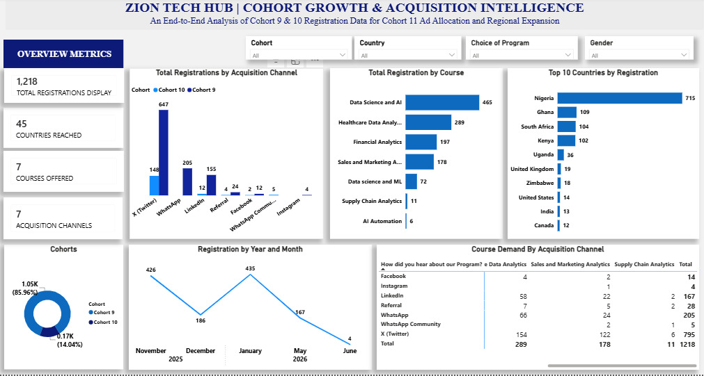

[← Back to portfolio](https://ozonzeadi1.github.io/#projects)

# Zion Tech Hub: Cohort Growth & Acquisition Intelligence

**Tool:** Power BI  **Domain:** Marketing and growth analytics  **Type:** Interactive dashboard

## Business question

Zion Tech Hub runs training cohorts across several data courses. Before launching **Cohort 11**, the team needed to know:

1. Which acquisition channels actually bring in registrations?
2. Which courses are in highest demand, and through which channels?
3. Which countries outside Nigeria are worth targeting next?
4. When in the year do registrations peak?

## Data

- Registration records for **Cohort 9 and Cohort 10** (1,218 registrations)
- Fields used: cohort, country, course (choice of programme), gender, acquisition channel ("How did you hear about our programme?") and registration date

## Approach

1. **Cleaning:** standardised channel and course names and checked for blanks and duplicates.
2. **Modelling:** built measures for total registrations, distinct countries, courses and channels.
3. **Dashboard design:**
   - KPI cards: total registrations, countries reached, courses offered, acquisition channels
   - Clustered bar chart: registrations by channel, split by cohort
   - Bar charts: registrations by course and the top 10 countries
   - Donut chart: share of registrations by cohort
   - Line chart: registrations by year and month
   - Matrix: course demand by acquisition channel
   - Slicers: cohort, country, choice of programme and gender

## Key metrics

| Metric | Value |
|---|---|
| Total registrations | 1,218 |
| Countries reached | 45 |
| Courses offered | 7 |
| Acquisition channels | 7 |
| Cohort 9 share | ~1,047 (85.96%) |
| Cohort 10 share | ~171 (14.04%) |

## Findings

- **X (Twitter) is the dominant channel:** 795 of 1,218 registrations (65%). WhatsApp (205) and LinkedIn (167) follow, and Facebook, Instagram, referrals and the WhatsApp community add very little.
- **Nigeria drives most demand** with 715 registrations. **Ghana (109), South Africa (104) and Kenya (102)** are the next-largest markets, well ahead of the rest.
- **Data Science & AI is the most popular course** (465), followed by Healthcare Data Analytics (289), Financial Analytics (197) and Sales & Marketing Analytics (178).
- **Registrations are seasonal.** They peaked in November 2025 (426) and January 2026 (435), then fell through May (167) and June (4).
- **Cohort 10 registered far fewer people than Cohort 9.** Most of the drop came from X (Twitter), which went from 647 to 148.

## Recommendations for Cohort 11

1. **Put most of the ad budget into X (Twitter),** but investigate why its performance fell sharply between Cohorts 9 and 10.
2. **Keep WhatsApp and LinkedIn as secondary channels.** Together they bring in nearly a third of sign-ups (31%).
3. **Target Ghana, South Africa and Kenya** for regional expansion.
4. **Lead campaigns with Data Science & AI and Healthcare Data Analytics.**
5. **Time campaigns for the November–January peak.**
