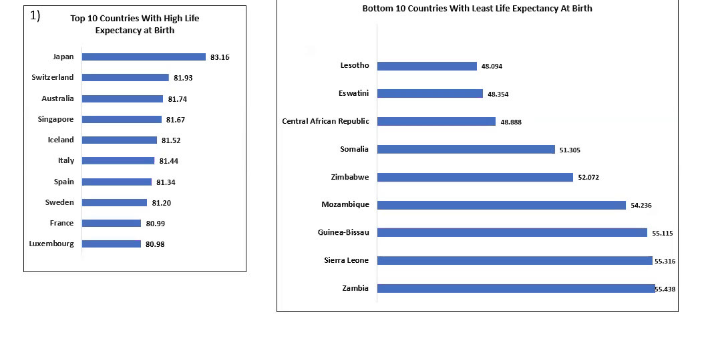
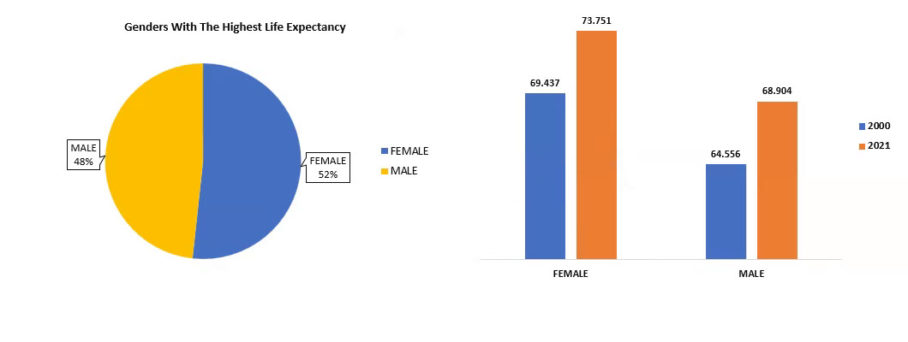
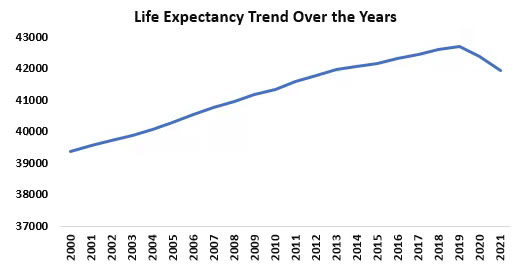

[← Back to portfolio](https://ozonzeadi1.github.io/#projects)

# Global Life Expectancy at Birth (2000–2021)

**Tools:** Microsoft Excel, PowerPoint  **Domain:** Public health  **Type:** Analytical report

Report by Ozonzeadi Adaeze Somtochukwu, 15 April 2026.
📽️ [Watch the report walkthrough](life-expectancy-walkthrough.mp4)

## Data summary

The dataset records global life expectancy at birth across countries and genders over the 21 years from **2000 to 2021**. It shows how long people can expect to live in different socio-economic settings, which makes it a useful lens on global health standards.

## Observations before analysis

- Some redundant columns needed cleaning
- The data is clearly split by gender (male and female)
- The dataset covers many years and many countries

## Questions

1. Which 10 countries have the highest life expectancy, and which 10 have the lowest?
2. Which gender has the higher life expectancy?
3. How did each gender's life expectancy change between 2000 and 2021, and what is the overall trend?

## Approach

1. Removed redundant columns and cleaned the data in Excel
2. Summarised life expectancy by country, gender and year (pivot tables)
3. Built ranking, gender-comparison and trend charts
4. Presented the findings in a short report deck

## Visuals

### Top 10 vs bottom 10 countries

| Top 10 | Years | Bottom 10 | Years |
|---|---|---|---|
| Japan | 83.16 | Lesotho | 48.09 |
| Switzerland | 81.93 | Eswatini | 48.35 |
| Australia | 81.74 | Central African Republic | 48.89 |
| Singapore | 81.67 | Somalia | 51.31 |
| Iceland | 81.52 | Zimbabwe | 52.07 |
| Italy | 81.44 | Mozambique | 54.24 |
| Spain | 81.34 | Guinea-Bissau | 55.12 |
| Sweden | 81.20 | Sierra Leone | 55.32 |
| France | 80.99 | Zambia | 55.44 |
| Luxembourg | 80.98 | | |

### Gender comparison

| Gender | 2000 | 2021 | Change |
|---|---|---|---|
| Female | 69.44 | 73.75 | +4.31 |
| Male | 64.56 | 68.90 | +4.35 |

Females account for 52% of the total life-expectancy value and males for 48%.

### Global trend

## Insights

- **Japan has the highest life expectancy** (83.16 years). This reflects the high priority it places on healthcare, diet and a healthy environment.
- **Sub-Saharan Africa needs urgent intervention in healthcare access.** Every country in the bottom 10 is in the region, and Lesotho, Eswatini and the Central African Republic are all below 49 years.
- **Global longevity peaked in 2019.** The sharp drop through 2021 likely reflects the impact of the COVID-19 pandemic.
- **Females outlive males globally.** The gap of about 4.9 years held steady from 2000 to 2021, even as both genders gained more than 4 years.
