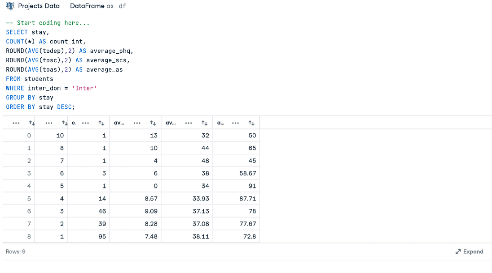

[← Back to portfolio](https://ozonzeadi1.github.io/#projects)

# Analysing International Students' Mental Health

**Tool:** PostgreSQL (DataCamp DataLab)  **Domain:** Education and mental health  **Type:** SQL analysis

📄 [Notebook export (PDF)](student-notebook.pdf) · 🧾 [SQL query](student-query.sql) · 📊 [Results (CSV)](student-results.csv)

## Background

Does going to university in a different country affect your mental health? In 2018 a Japanese international university surveyed its students, and the study was published the following year after approval by several ethical and regulatory boards.

The study found that international students have a higher risk of mental-health difficulties than the general population. It also found that **social connectedness** (belonging to a social group) and **acculturative stress** (stress from adjusting to a new culture) predict depression.

**My goal:** use SQL to see whether the data supports a similar conclusion for international students, and whether **length of stay** plays a part.

## Data

The `students` table has 286 rows. Columns used:

| Field | Description |
|---|---|
| `inter_dom` | Type of student (international or domestic) |
| `japanese_cate` | Japanese language proficiency |
| `english_cate` | English language proficiency |
| `academic` | Current academic level (undergraduate or graduate) |
| `age` | Current age of student |
| `stay` | Current length of stay in years |
| `todep` | Total depression score (PHQ-9 test) |
| `tosc` | Total social connectedness score (SCS test) |
| `toas` | Total acculturative stress score (ASISS test) |

## Query

```sql
SELECT stay,
       COUNT(*)               AS count_int,
       ROUND(AVG(todep), 2)   AS average_phq,
       ROUND(AVG(tosc), 2)    AS average_scs,
       ROUND(AVG(toas), 2)    AS average_as
FROM students
WHERE inter_dom = 'Inter'
GROUP BY stay
ORDER BY stay DESC;
```

## Results



| Stay (years) | Students | Avg depression (PHQ-9) | Avg social connectedness (SCS) | Avg acculturative stress (ASISS) |
|---|---|---|---|---|
| 10 | 1 | 13.00 | 32.00 | 50.00 |
| 8 | 1 | 10.00 | 44.00 | 65.00 |
| 7 | 1 | 4.00 | 48.00 | 45.00 |
| 6 | 3 | 6.00 | 38.00 | 58.67 |
| 5 | 1 | 0.00 | 34.00 | 91.00 |
| 4 | 14 | 8.57 | 33.93 | 87.71 |
| 3 | 46 | 9.09 | 37.13 | 78.00 |
| 2 | 39 | 8.28 | 37.08 | 77.67 |
| 1 | 95 | 7.48 | 38.11 | 72.80 |

## Findings

- **201 international students** are in the data, and 194 of them (97%) have stayed 1–4 years.
- Over those first four years, **acculturative stress rises steadily** from 72.8 to 87.7.
- **Depression scores edge up** from 7.48 in year 1 to about 9 in years 3–4.
- **Social connectedness dips slightly,** from 38.1 in year 1 to 33.9 in year 4.
- Groups who stayed 5+ years have only 1–3 students each, too few for reliable conclusions.

## Conclusion

Within the first four years, longer stays go with higher acculturative stress, slightly higher depression scores and slightly lower social connectedness. This fits the original study's conclusion that connectedness and acculturative stress are linked to depression. Universities could focus their support on international students in their 2nd to 4th years, not just new arrivals.

## Next steps

- Compare international with domestic students using the same metrics
- Break the results down by language proficiency and academic level
- Test the correlation between each score and depression directly
