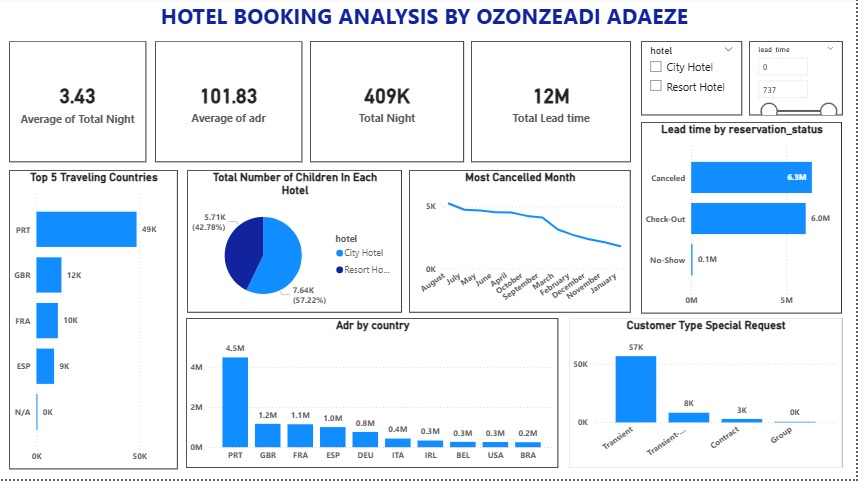

[← Back to portfolio](https://ozonzeadi1.github.io/#projects)

# Hotel Booking Analysis

**Tool:** Power BI  **Domain:** Hospitality and revenue analytics  **Type:** Interactive dashboard

## Business question

A business running a **City Hotel** and a **Resort Hotel** wants to understand its bookings better:

1. Where do most guests come from, and which markets bring in the most revenue?
2. When do cancellations happen, and how does booking lead time relate to them?
3. How do family bookings (guests with children) split between the two hotels?
4. Which customer types make the most special requests?

## Data

Booking-level hotel reservation data. Fields used include hotel type, country, lead time, stay length (week and weekend nights), ADR (average daily rate), number of children, reservation status, arrival month, customer type and total special requests.

## Approach

1. **Cleaning and preparation:** created a *Total Nights* column (weekend nights + week nights) and checked country codes and missing values.
2. **Measures:** average total nights, average ADR, total nights and total lead time.
3. **Dashboard design:**
   - KPI cards: average total nights, average ADR, total nights, total lead time
   - Bar chart: top 5 countries by guests
   - Pie chart: children by hotel
   - Line chart: cancellations by month
   - Bar chart: lead time by reservation status
   - Column chart: ADR by country
   - Column chart: special requests by customer type
   - Slicers: hotel type and lead-time range (0–737 days)

## Key metrics

| Metric | Value |
|---|---|
| Average length of stay | 3.43 nights |
| Average daily rate (ADR) | 101.83 |
| Total nights booked | 409K |
| Total lead time | 12M days |

## Findings

- **Portugal (PRT) is by far the biggest source market,** with about 49K guests. Great Britain (12K), France (10K) and Spain (9K) follow. Portugal also contributes the most total ADR (4.5M), nearly four times Great Britain (1.2M).
- **August has the most cancellations,** followed by July, May and June. January has the fewest. Cancellations follow the summer travel peak.
- **Cancelled bookings carry more total lead time (6.3M days) than completed stays (6.0M).** This suggests that bookings made far in advance are more likely to be cancelled.
- **The City Hotel hosts more children** (7.64K, 57%) than the Resort Hotel (5.71K, 43%).
- **Transient customers make most special requests** (57K), far more than transient-party (8K), contract (3K) and group (near 0) customers.

## Recommendations

1. **Reduce cancellations on long-lead bookings** with deposits, non-refundable rate options or reminder emails as the stay gets closer.
2. **Tighten the cancellation policy for June–August,** when cancellations peak, and consider controlled overbooking.
3. **Keep investing in the Portuguese market,** and grow the UK, French and Spanish markets with targeted campaigns.
4. **Market family packages,** especially at the City Hotel.
5. **Prepare staff for transient guests' requests,** for example with pre-arrival request forms.
